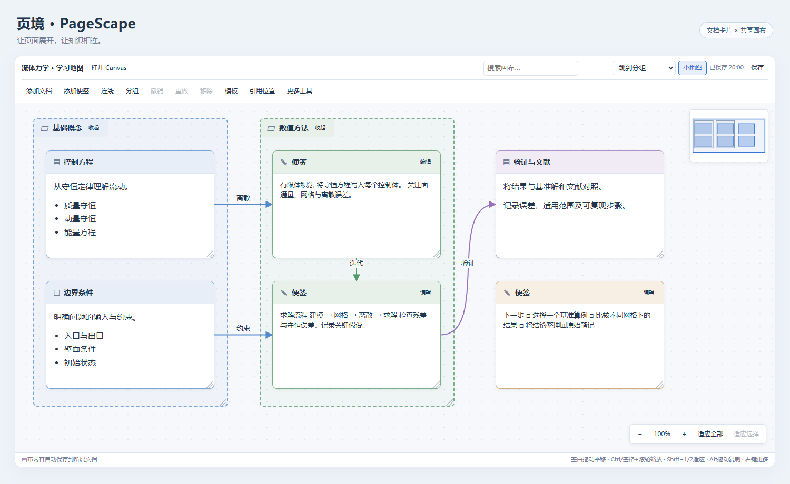

# 页境 · PageScape

**让页面展开，让知识相连。**

[English](README.en.md) · [下载安装包](https://github.com/dusknobo/PageScape/releases/latest) · [完整使用说明](https://github.com/dusknobo/PageScape/blob/main/docs/USAGE.zh-CN.md) · [更新记录](https://github.com/dusknobo/PageScape/blob/main/CHANGELOG.md)

PageScape 是一个思源笔记插件，将自动更新的子页卡片与可编辑 Canvas 带进文档正文。你可以在笔记中整理知识地图，也可以独立打开画布；多篇文档能引用同一张画布。



## 功能

| 功能 | 可以做什么 |
| --- | --- |
| 正文子页卡片 | 预览直接子页面，自动响应内容和目录变化；调整列数、高度与图片显示 |
| 共享正文画布 | 在任意正文位置新建或引用画布，多篇笔记共用同一份布局 |
| 多种内容卡片 | 文档、文档片段、Markdown 便签、图片、PDF、音视频和网页 |
| 自由编辑与布局 | 拖动、缩放、多选、复制粘贴、撤销重做、对齐、网格及树形布局 |
| 分组与连线 | 折叠分组、背景图片、连线说明、方向、颜色、重新连接与沿线跳转 |
| 子页自动跟随 | 新子页自动加入，保留已有位置；移出的子页标记状态，手动移除的卡片保持排除 |
| 搜索与导航 | 搜索卡片文字和已加载预览，使用小地图和分组定位 |
| 反向引用 | 从原文找到引用它的画布，也可查找画布嵌入了哪些文档 |
| 模板 | 内置公式推导、论文阅读、模块依赖模板；自定义模板保存为普通画布文档 |
| 原生文档保存 | 自动保存、另存副本、冲突草稿保护，支持 JSON Canvas 和 PNG 导出 |

## 安装

当前版本 **0.6.1**；最低思源版本 **3.8.3**，已在 **3.8.8** 验证。主要支持桌面端与桌面浏览器，尚未提交思源集市。

1. 从 [Releases](https://github.com/dusknobo/PageScape/releases/latest) 下载 **package.zip**。
2. 解压到 `<思源工作空间>/data/plugins/siyuan-child-cards/`。
3. 确认该目录下直接包含 `plugin.json`、`index.js` 等文件，再在思源插件设置中启用 **页境 · PageScape**。

更新前先禁用插件，再替换插件文件。Release 同时提供 `SHA256SUMS`，可用于核对下载文件。

> 插件内部 ID 继续使用 `siyuan-child-cards`。请保留这个安装目录名，以兼容已有自定义块、画布引用和旧版存储。仓库名及显示名称为 PageScape。

## 快速开始

| 入口 | 操作 |
| --- | --- |
| `/cards`、`/childcards`、`/子页卡片` | 插入自动更新的子页预览卡片 |
| `/embedcanvas`、`/inlinecanvas`、`/嵌入画布` | 在正文新建或引用可编辑画布 |
| `/newcanvas` | 新建画布文档并独立打开 |
| `/canvas` | 打开已有画布 |

画布默认使用紧凑工具栏。**更多工具** 中包含子页跟随、附件、自动排列、设置与导入导出。右键卡片、分组和连线可找到更多操作。

正文画布可以直接编辑便签；在独立 Canvas 中，还可通过原生编辑器修改文档卡片的原文。正文中的文档卡片双击后打开源文档。

## 数据与使用范围

- 每张画布保存为一个普通思源文档；嵌入块只保存来源引用，不另存一份布局。
- 多篇笔记引用同一张画布时，修改会反映到各处。移除卡片或删除引用块不会删除源文档。
- 画布沿用思源已有的文档历史和同步配置；插件不会自行部署服务器或启用同步。
- 搜索包含卡片标题、便签、文档 ID 和已加载的预览，不扫描所有原文全文。
- 反向引用基于插件布局和引用块，与思源原生反链统计分开。
- `.canvas` 交换布局及思源扩展数据，不自动把笔记转换成 Obsidian vault。
- 移动端目前显示概要；不包含手绘和实时多人协作。

设置、快捷键、旧版 JSON 迁移及保存冲突处理见 [完整使用说明](https://github.com/dusknobo/PageScape/blob/main/docs/USAGE.zh-CN.md)。

## 开发与验证

需要 Node.js 22 或更高版本：

```sh
npm ci
npm run typecheck
npm test
npm run build
npm run verify:package
```

安装文件生成于 `dist/`，压缩包为 `package.zip`。构建只打包明确列出的插件文件；测试笔记、缓存、日志与本机配置不进入安装包或仓库。

更多开发步骤及隔离编辑器测试见 [CONTRIBUTING.md](https://github.com/dusknobo/PageScape/blob/main/CONTRIBUTING.md)。

## 许可

[MIT](https://github.com/dusknobo/PageScape/blob/main/LICENSE)。
